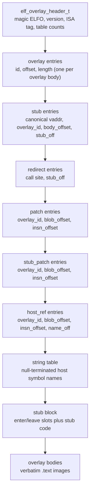
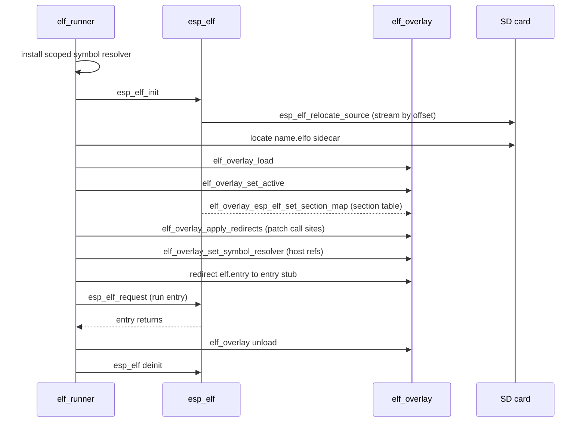

# Overlay format (`.elfo`)

Every packed app carries two artifacts: the relocatable `<name>.app.elf` and a sidecar `<name>.elfo`. The ELF is the program; the ELFO blob is the overlay image the host pages into executable RAM at load time. The build produces the `.elfo` automatically (see [build.md](build.md)); this page documents what it contains and how the loader consumes it, so the format is pinned contract rather than an implementation detail.

The overlay runtime lives in the `elf_overlay` component, an ISA-abstracted overlay loader that sits next to the ELF loader (`esp_elf`) and handles the parts of loading that a plain relocating loader cannot: paging `.text` bodies into a fixed pool of executable frames and patching ISA-specific PC-relative literal loads once the resident addresses are known.

## Why it exists

An ELF app links `-nostdlib -shared` and resolves every symbol from the host at load time (see [app-abi.md](app-abi.md) and [symbols.md](symbols.md)). On the ESP32-S3 the loader must place executable code in memory that the instruction bus can fetch (`MALLOC_CAP_EXEC`), which is scarce. Mapping an entire app image into exec RAM wastes that budget on code paths that may never run.

The overlay model solves this. Instead of loading all `.text` up front, the host relocates the base image with `esp_elf`, then pages individual overlay bodies into a small pool of exec-RAM frames on demand. A function that is never called is never paged in. The `.elfo` blob is the pre-chewed form the device needs for that: the overlay bodies, the stub block that enters and leaves them, and the relocation patch tables the host applies once it knows where each frame landed.

PC-relative literal loads (`l32r` on Xtensa, `auipc` on RISC-V) cannot be left to the base relocator, because the literal's absolute address is not known until the overlay body is resident. `elf_overlay` patches those in place at page-in. The base relocator never touches them.

## On-disk layout

The blob begins with the four-byte magic `ELFO`, format version 1, and an ISA tag. All multi-byte fields are little-endian, matching the app ELF. The header is followed by fixed-shape tables and two data regions:



| Table        | What it records                                                         |
| ------------ | ----------------------------------------------------------------------- |
| overlay      | Each overlay body's id, its offset into the bodies region, and length.  |
| stub         | Maps a canonical `.text` virtual address to the stub that enters it.    |
| redirect     | Resident call sites that must be patched to jump through a stub.        |
| patch        | ISA literal-load sites inside overlay bodies, patched at page-in.       |
| stub_patch   | ISA literal-load sites inside the stub block.                           |
| host_ref     | Overlay references to host symbols, resolved by name via the resolver.  |
| string table | The host symbol names the `host_ref` entries point into.                |

All tables are fixed-size records, so parsing and page-in do no heap allocation beyond the frame pool itself.

## ISA abstraction

ISA-specific patching lives behind `elf_overlay_isa_ops_t`. Two backends are registered:

- `xtensa` - `l32r` PC-relative literal patching, validated against the Xtensa ISA reference. This is the backend PocketMage uses on the S3.
- `riscv` - `auipc` PC-relative literal patching.

The ISA tag in the header selects the backend at load time. A blob built for one ISA will not load on another.

## How the host consumes it

The in-process runner (`src/elf_runner.cpp`) loads an app in two stages: the base relocation with `esp_elf`, then the overlay with `elf_overlay`. The exact sequence, matching the code:

1. Install the scoped symbol resolver (see [symbols.md](symbols.md)), then `esp_elf_init` and `esp_elf_relocate_source` relocate the base image. The image is streamed by offset from the SD file rather than held whole in RAM.
2. Locate the `.elfo` sidecar next to the ELF and `elf_overlay_load` it.
3. `elf_overlay_set_active` makes it the active overlay for the run.
4. `elf_overlay_esp_elf_set_section_map` copies the relocated section table (canonical virtual address to resident address) from the `esp_elf_t` into the overlay's section map.
5. `elf_overlay_apply_redirects` patches the resident call sites so calls into paged functions go through their stubs.
6. `elf_overlay_set_symbol_resolver` wires host-reference resolution back through the scoped resolver, so an overlay body calling a `pm_*` or runtime symbol resolves against the host export table.
7. The entry point is redirected: the runner finds the stub for the entry's canonical virtual address and rewrites `elf.entry` to the stub address, so even the first call pages the entry body in.
8. `esp_elf_request` runs the entry. On return, the overlay is unloaded and the base image deinitialized.



If the sidecar is absent, the app runs unredirected from the base relocation alone. Apps packed with `make pack` always ship the sidecar; see the pack contract in [publishing](guides/publishing.md).

### The frame pool

A fixed pool of executable-RAM frames holds overlay bodies, paged in on demand. A stub's `enter` bumps the target frame's refcount and `leave` drops it; a frame stays resident while its refcount is above zero. Literals are patched in place inside the `.text` image at page-in, once resident addresses are known. The PC-relative instructions themselves (`l32r` / `auipc`) are never rewritten.

The pool is sized by compile-time constants in the overlay component (`ELF_OVERLAY_MAX_FRAMES`, default 4; `ELF_OVERLAY_DEFAULT_FRAME_SIZE`, default 16384 bytes). A single overlay body must fit in one frame.

## Building the blob

`tools/app.mk` emits the `.elfo` in two steps from the unstripped link output (`<name>.app.tool`):

```text
elf_overlay_relink <name>.app.tool <name>.relk   # scan .text, classify relocs
elf_overlay_emit   <name>.relk     <name>.elfo   # pack into the ELFO blob
```

`elf_overlay_relink` reads the ELF32 executable, scans `.text` for ISA patch sites, builds a literal pool, classifies relocations, and writes a `.relk` intermediate. `elf_overlay_emit` packs that into the final ELFO blob. Both tools must be on `PATH`; the SDK build expects them from an `elf_overlay` checkout (CI builds them with CMake and prepends the build dir to `PATH`). Override `ELF_OVERLAY_RELINK` and `ELF_OVERLAY_EMIT` to point at specific binaries.

## Stability

The ELFO magic, version, and table layout are load contract. A format change takes a version bump in the header and a matching host loader that accepts the new version. The `elf_overlay` component is the single source of truth for the format; see its `README.md` and `include/elf_overlay/` headers for the exact record definitions.
